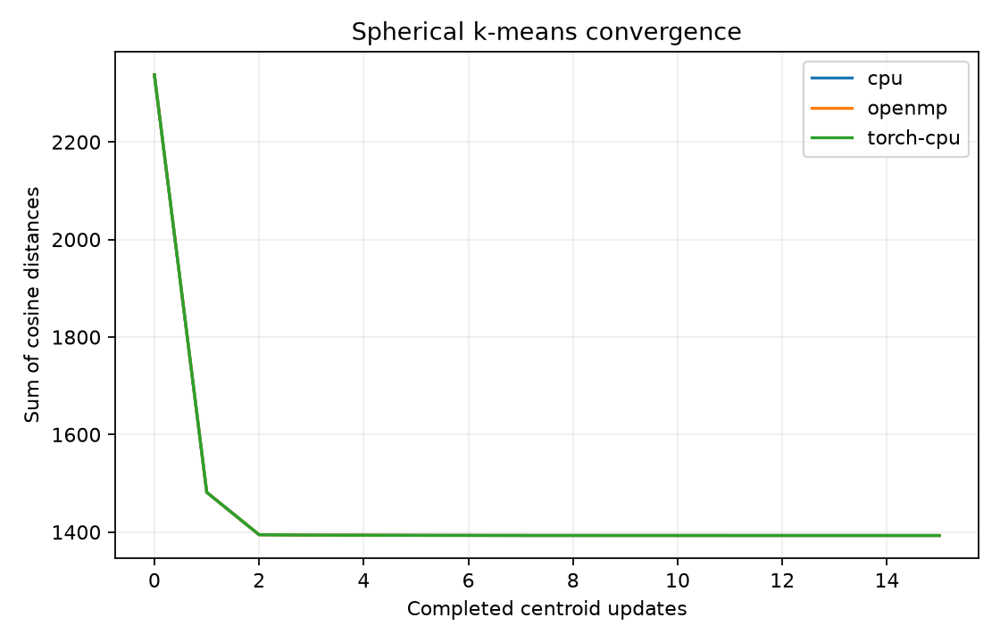

# Hybrid MPI–CUDA Embedding Clustering

**C++17 · MPI · OpenMP · CUDA · cuBLAS · Python · CMake**

Spherical k-means for normalized embeddings, with cluster representatives and outlier ranking. The project combines local parallel kernels with an MPI execution path that partitions data, reduces centroid statistics, and reconstructs global results.

**Measured result:** 1.91× OpenMP speedup over sequential C++ on 8,000 points with 12 clusters and 15 centroid updates. The implementation also includes scalar CUDA, shared-memory accumulation, and cuBLAS assignment variants.

**Execution status:** CPU/OpenMP, PyTorch CPU, and single-process MPI verified. Multi-rank MPI, CUDA/cuBLAS, and MPS execution remain pending; no distributed or GPU speedup is claimed.

## Distributed architecture


Each iteration maximizes point-to-center cosine similarity, accumulates member sums/counts, and normalizes the updated centers. Final labels are recomputed after the last center update. An empty or zero-sum cluster retains its previous center.

## Engineering decisions

| Component | Implementation and rationale |
|---|---|
| CPU reductions | OpenMP workers maintain private centroid sums before merging, avoiding a shared floating-point atomic update for every feature. Temporary storage is O(threads × clusters × dimensions). |
| CUDA accumulation | The scalar variant uses global atomics. The tiled variant aggregates cluster/feature partial sums in shared memory before global merging. |
| Assignment alternatives | Per-point scalar CUDA, tiled similarity, and cuBLAS FP32 SGEMM expose the computation/memory tradeoff of materializing an N×K score matrix. |
| MPI partitioning | `MPI_Scatterv`/`MPI_Gatherv` support unequal row counts, including empty local partitions. `MPI_Allreduce` combines centroid sums/counts and objective values. |
| Threading contract | `MPI_THREAD_FUNNELED` keeps MPI calls on the main thread while local work uses OpenMP. GPU workers select devices using node-local rank. |
| Reproducible comparison | All backends receive identical seeded centers and execute the same number of updates. Quality checks use objective values and final assignments, accounting for floating-point reduction differences. |
| Timing boundaries | Reports separate launcher wall time from the native MPI compute loop and collective time; local-process results are not presented as multi-node scaling. |

See the [MPI driver](native/mpi_main.cpp), [CPU/OpenMP reductions](native/ops.cpp), [CUDA assignment/update kernels](native/cuda_ops.cu), and [quality checks](src/distributed_clustering/app.py).

## Benchmark results

**Workload:** 8,000 normalized 64-dimensional points, 12 clusters, and 15 centroid updates. Measurements are single-process CPU wall times on Apple silicon/macOS, with one warm-up and the median of three samples.

| Backend | Pipeline time | Speedup vs. sequential C++ |
|---|---:|---:|
| C++ / SIMD, 1 thread | 4.970 ms | 1.00× |
| C++ / OpenMP, 4 threads | 2.600 ms | 1.91× |
| PyTorch CPU, 4 threads | 3.605 ms | 1.38× |

Times include allocation, assignment, centroid updates, and objective evaluation. Dataset generation/loading, initialization selection, and report writing are excluded.

| Quality metric | Synthetic demo result |
|---|---:|
| Final OpenMP objective: sum of cosine distances | 1,392.9934 |
| Relative objective difference, OpenMP vs. sequential C++ | 3.14e-8 |
| Inlier label agreement after matching cluster IDs | 80.4% |
| Recall@240 for 240 injected uniform outliers | 100.0% |

The outlier metric ranks the known number of injected points; it does not establish an anomaly threshold for unlabeled data. Spherical k-means is initialization-sensitive, and the inlier agreement exposes incomplete recovery of the synthetic source groups.



[Raw samples and configuration](examples/results.json) · [Size/thread scaling plot](examples/scaling.png) · [Cluster representatives](examples/cpu-clusters.csv) · [Ranked outliers](examples/cpu-outliers.csv)

The snapshot predates repository separation; the standalone checkout was subsequently built and tested in isolation. MPI rank-one results were checked against the native reference, while the development session blocked multi-rank launcher sockets. GPU timings and multi-node scaling results are not available.

## Build and reproduce

With Python 3.13, a C++17 compiler, CMake, OpenMP, and an MPI implementation installed:

```bash
python3.13 -m venv .venv
source .venv/bin/activate
python -m pip install -r requirements-dev.txt
python scripts/build.py --no-cuda
python -m unittest discover -s tests -v
python run.py --rows 8000 --dim 64 --clusters 12 --iterations 15 \
  --backends cpu openmp torch-cpu --threads 4 --repeats 3 --output results/local
python scripts/sweep.py --sizes 1000 8000 32000 --threads 1 2 4
```

<details>
<summary>Platform dependencies</summary>

On Apple silicon, install the native toolchain dependencies before creating the virtual environment:

```bash
brew install python@3.13 cmake ninja libomp open-mpi
```

On Debian/Ubuntu, install a compatible Python and the native build dependencies:

```bash
sudo apt-get install build-essential cmake ninja-build libomp-dev libopenmpi-dev openmpi-bin
```

The build helper selects the installed macOS SDK and reuses PyTorch's OpenMP runtime when present, avoiding duplicate-runtime initialization. Rebuild after moving the checkout or virtual environment.

</details>

From a terminal that permits MPI process launches:

```bash
python run.py --backends cpu openmp --mpi-ranks 1 2 4 --output results/mpi
HPC_TEST_MPI=1 python -m unittest discover -s tests -v
```

Local MPI ranks exercise process cooperation; networked strong/weak scaling requires multiple nodes. The native executable is `build/hpc_cluster_mpi`; [the algorithm guide](docs/ALGORITHM.md) documents its raw-file interface. Use `--input-file embeddings.npy` for real embeddings and `--initial-file centers.npy` to supply common initial centers.

On NVIDIA hardware with a CUDA toolkit:

```bash
python scripts/build.py
python -m unittest discover -s tests -v
python run.py --backends cuda-naive cuda-optimized cublas --output results/cuda
```

[Single-GPU](scripts/benchmark_gpu.sbatch), [MPI/OpenMP](scripts/cluster_mpi_cpu.sbatch), and [MPI/CUDA](scripts/cluster_mpi_gpu.sbatch) Slurm templates are included. Adapt account, partition, and environment settings for the target cluster.

## Correctness and remaining work

**Five tests pass; one opt-in multi-rank test is skipped** in the restricted development environment. Checks cover objective monotonicity and consistency, unit center norms, final nearest-center assignments, duplicate/empty centers, zero points, real-file execution, and MPI rank-one agreement. The opt-in MPI test covers uneven partitions and more ranks than points when run in an unrestricted environment. See [standalone validation](docs/VALIDATION.md).

CUDA/cuBLAS assignment materializes N×K scores in the tiled modes, while the scalar path avoids that matrix. The MPI/CUDA worker currently allocates and transfers local arrays each iteration. Keeping embeddings resident on the device and overlapping communication are follow-up optimizations, alongside NVIDIA correctness/profiling runs and measured multi-node scaling.

| Path | Contents |
|---|---|
| [native/mpi_main.cpp](native/mpi_main.cpp) | MPI partitioning, collectives, thread/device setup, timing |
| [native/](native/) | C++/OpenMP and CUDA/cuBLAS numerical kernels |
| [src/distributed_clustering/](src/distributed_clustering/) | Initialization, backend adapters, quality metrics, reports |
| [tests/](tests/) | Numerical contracts, CLI integration, and MPI checks |
| [docs/ALGORITHM.md](docs/ALGORITHM.md) | Algorithm, file formats, and scaling methodology |

Each checkout is independent. Inspired by CS759 material on embedding clustering, SIMD reductions, and hybrid MPI/OpenMP execution.
